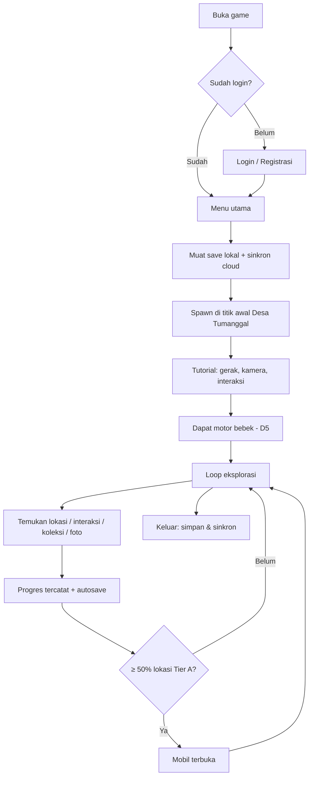

# Product Requirements Document (PRD)

**Produk:** Open World Real Map — Desa Tumanggal
**Status:** Draft v2 · **Terakhir diperbarui:** 2026-11-20
**Dokumen terkait:** [technical-architecture.md](technical-architecture.md) · [roadmap.md](roadmap.md) · [../CLAUDE.md](../CLAUDE.md)

> Dokumen ini hanya membahas **apa** dan **mengapa** (produk). Detail **bagaimana** (arsitektur, skema database, API, tech stack) ada di `technical-architecture.md`.

---

## 1. Ringkasan

Game eksplorasi 3D open world yang dunianya dibangun dari **peta dunia nyata**, dimulai dari **Desa Tumanggal, Kec. Pengadegan, Kab. Purbalingga, Jawa Tengah**. Pemain mengendalikan karakter **faceless** (wajah hanya menampilkan sepasang mata), menjelajah desa dengan berjalan kaki atau berkendara **motor** dan **mobil**, serta menemukan lokasi-lokasi nyata yang dimodelkan semirip mungkin dengan kondisi aslinya.

Pengembangan dilakukan **bertahap per rilis**: setiap rilis menambah cakupan peta, bangunan, dan fitur tanpa merusak fondasi sebelumnya.

### 1.1 Masalah

- Belum ada pengalaman menjelajahi lokasi nyata pedesaan Indonesia dalam bentuk game 3D yang imersif.
- Belum ada kanal interaktif untuk memperkenalkan wilayah (desa, landmark, jalan) kepada orang luar maupun warga perantau.

### 1.2 Target Pengguna

| Persona | Kebutuhan |
|---|---|
| **Pemain eksplorasi / open world** | Dunia yang bisa dijelajah bebas, kendaraan yang enak dikendarai, rasa "menemukan" tempat. |
| **Warga / perantau Purbalingga** | Mengenali tempat nyata (rumah, jalan, masjid, sekolah, sawah) di dalam game. |
| **Pemerhati wilayah / pemerintah desa** *(sekunder)* | Media promosi dan dokumentasi visual desa. |

### 1.3 Value Proposition

1. **Lokasi nyata yang dikenali** — tata letak jalan dan bangunan mengikuti data geografis asli.
2. **Identitas visual khas** — karakter faceless yang hanya bermata, konsisten di seluruh game.
3. **Eksplorasi berkendara** — motor dan mobil sebagai cara utama menempuh jarak, sesuai keseharian desa.

### 1.4 Tujuan & Metrik Keberhasilan (Rilis Awal / MVP)

| Tujuan | Metrik | Target |
|---|---|---|
| Dunia terasa "nyata" | % responden lokal yang mengenali ≥ 5 landmark dalam playtest | ≥ 80% |
| Eksplorasi menarik | Median durasi sesi pertama | ≥ 20 menit |
| Pemain kembali | Retensi D7 (pemain playtest) | ≥ 25% |
| Teknis stabil | Crash-free session | ≥ 99% |
| Performa layak | FPS pada spesifikasi minimum (lihat §6) | ≥ 60 FPS (rata-rata), ≥ 45 FPS (1% low) |

### 1.5 Non-Goals (di luar scope MVP)

- Multiplayer / co-op real-time.
- Sistem ekonomi, toko, atau pembelian dalam aplikasi (IAP).
- Pertarungan / combat.
- Kustomisasi karakter selain warna & gaya mata.
- Wilayah di luar batas Desa Tumanggal.
- Platform mobile dan konsol (direncanakan setelah PC stabil).

---

## 2. Keputusan Produk

Draft sebelumnya merujuk ke "kuesioner" tanpa menuliskan jawabannya. Bagian ini menjadi **satu-satunya sumber kebenaran** untuk keputusan tersebut. Item berstatus **Usulan** adalah default yang dipakai tim selama belum ada keputusan resmi dari pemilik produk.

| # | Keputusan | Nilai | Status |
|---|---|---|---|
| D1 | Cakupan peta MVP | Batas administratif Desa Tumanggal, ditambah buffer ±200 m untuk jalan penghubung. Di luar batas: dinding tak terlihat + kabut jarak jauh. | Usulan |
| D2 | Tingkat kemiripan bangunan | **3 tier**: *Tier A* landmark (masjid, balai desa, sekolah, ±10–20 bangunan) dimodelkan manual dengan referensi foto; *Tier B* bangunan di tepi jalan utama, modular dengan proporsi & warna dari survei; *Tier C* bangunan lain, procedural dari footprint OSM. Sampai survei lapangan selesai, semua bangunan sementara diperlakukan sebagai Tier C di posisi footprint asli. Footprint diambil dari OSM, lalu dilengkapi Google Open Buildings/Microsoft untuk bangunan yang belum ada di OSM (ADR-0003). Gang, jalan setapak, sawah, dan kebun didigitasi manual di OSM. | Usulan |
| D3 | Karakter yang wajib faceless | **Semua** karakter humanoid (pemain dan NPC bila ditambahkan). | Usulan |
| D4 | Tingkat detail mata | **Menengah**: bentuk dasar + iris + pupil + highlight, animasi kedip & arah pandang. Tanpa alis, bulu mata, atau ekspresi kompleks. | Ditetapkan (dari aturan proyek lama) |
| D5 | Mekanisme perolehan kendaraan | Motor bebek diberikan di awal (tutorial). Mobil terbuka setelah pemain menemukan ≥ 50% lokasi Tier A. Tanpa mata uang. | Usulan |
| D6 | Aktivitas utama | (1) Penemuan lokasi (*location discovery*), (2) interaksi objek/landmark (panel info), (3) koleksi item tersebar, (4) foto mode untuk landmark. | Usulan |
| D7 | Platform rilis awal | PC Windows (64-bit). Distribusi awal: itch.io / build langsung untuk playtest; Steam setelah polish. | Usulan |
| D8 | Model akun | Akun wajib untuk *cloud save*; progres tetap tersimpan lokal agar bisa main saat offline dan disinkronkan saat online. | Usulan |

> Setiap perubahan pada tabel ini WAJIB diikuti pembaruan `roadmap.md` dan, bila menyentuh aturan teknis, `.claude/rules/domain.md`.

---

## 3. Requirements

### 3.1 Functional Requirements

| ID | Requirement | Prioritas |
|---|---|---|
| FR-01 | Dunia 3D dibangun dari data geografis nyata (jalan, kontur tanah, footprint bangunan) Desa Tumanggal, dapat dijelajahi bebas. | Must |
| FR-02 | Cakupan dunia dibatasi sesuai D1 dan dirancang agar bisa diperluas per wilayah tanpa membangun ulang wilayah lama. | Must |
| FR-03 | Bangunan ditampilkan sesuai tier kemiripan D2; seluruh bangunan memiliki collider. | Must |
| FR-04 | Karakter pemain faceless: hanya sepasang mata, tanpa hidung, mulut, telinga, alis (D3). | Must |
| FR-05 | Mata dirender sesuai tingkat detail D4, termasuk kedip dan arah pandang. | Must |
| FR-06 | Kendaraan motor dan mobil dapat dinaiki, dikendarai, dan ditinggalkan di mana saja dalam dunia. | Must |
| FR-07 | Kendaraan diperoleh sesuai mekanisme D5; kepemilikan tersimpan per akun. | Must |
| FR-08 | Aktivitas eksplorasi D6 tersedia dan progresnya tercatat. | Must |
| FR-09 | Peta dunia (world map) dan minimap menampilkan posisi pemain, kendaraan, dan lokasi yang sudah ditemukan. | Should |
| FR-10 | Simpan otomatis (autosave) progres secara lokal dan sinkron ke cloud. | Must |
| FR-11 | Login/registrasi akun dan pemulihan sesi. | Must |
| FR-12 | Pengaturan grafis (preset kualitas, resolusi, FOV) dan kontrol (keyboard-mouse, gamepad, remap tombol). | Should |
| FR-13 | Siklus siang–malam sederhana. | Could |

### 3.2 Non-Functional Requirements

| ID | Kategori | Requirement |
|---|---|---|
| NFR-01 | Performa | ≥ 60 FPS rata-rata pada spesifikasi minimum (§6). |
| NFR-02 | Loading | Masuk ke dunia ≤ 30 detik dari menu pada SSD; tidak ada *hitch* > 100 ms saat streaming chunk. |
| NFR-03 | Memori | Penggunaan RAM ≤ 4 GB, VRAM ≤ 2 GB pada preset Medium. |
| NFR-04 | Ketahanan data | Tidak ada kehilangan progres lebih dari 60 detik permainan saat crash/putus koneksi. |
| NFR-05 | Keamanan | Password di-hash (Argon2id), seluruh trafik via HTTPS, token akses berumur pendek. |
| NFR-06 | Lisensi data | Data peta mengikuti lisensi sumbernya (mis. atribusi OpenStreetMap ODbL, Google Open Buildings CC BY 4.0, Microsoft ML Building Footprints ODbL, dan Copernicus DEM ditampilkan di kredit). Digitasi manual ke OSM hanya boleh men-trace citra yang lisensinya mengizinkan tracing untuk OSM. Citra satelit berlisensi terbatas hanya dipakai sebagai referensi modeling, bukan tekstur. |
| NFR-07 | Privasi | Tidak menampilkan nama pemilik rumah pribadi atau data pribadi warga; bangunan pribadi diberi label generik. Persetujuan pemerintah desa untuk publikasi landmark. |
| NFR-08 | Skalabilitas konten | Menambah wilayah baru cukup lewat pipeline data + Addressables tanpa mengubah kode inti. |
| NFR-09 | Aksesibilitas | Subtitle/teks berukuran dapat diatur, opsi colorblind untuk penanda peta, remap kontrol. |

---

## 4. Core Features

1. **Eksplorasi dunia nyata** — Berjalan, berlari, dan memanjat ringan di Desa Tumanggal. Jalan, sungai, sawah, dan kontur tanah mengikuti data asli.
2. **Bangunan 3D semirip aslinya** — Landmark dimodelkan detail; bangunan lain mengikuti footprint dan proporsi asli (D2).
3. **Karakter faceless** — Identitas visual utama: wajah polos dengan sepasang mata ekspresif (kedip, melirik ke objek menarik).
4. **Berkendara motor & mobil** — Kontrol arkade yang responsif; motor lincah di gang sempit, mobil stabil di jalan utama.
5. **Aktivitas eksplorasi** — Menemukan lokasi, membaca info landmark, mengumpulkan item, dan mengambil foto (D6).
6. **Navigasi** — Minimap, world map, dan waypoint.

---

## 5. User Flow

1. **Masuk** — Pemain membuka game, login (atau melanjutkan sesi tersimpan).
2. **Spawn** — Dunia dimuat bertahap di sekitar titik awal; karakter faceless muncul.
3. **Tutorial singkat** — Gerak, kamera, interaksi, lalu menerima motor.
4. **Eksplorasi** — Pemain bebas menjelajah; lokasi baru memicu notifikasi penemuan.
5. **Progres** — Penemuan, koleksi, dan posisi terakhir disimpan otomatis.
6. **Membuka mobil** — Setelah ambang penemuan tercapai.
7. **Kembali lagi** — Pemain melanjutkan dari posisi terakhir; rilis berikutnya menambah wilayah baru.

---

## 6. Spesifikasi Minimum (PC)

| Komponen | Minimum | Rekomendasi |
|---|---|---|
| OS | Windows 10 64-bit | Windows 11 64-bit |
| CPU | 4 core (Intel i5 gen-8 / Ryzen 5 2600) | 6 core |
| RAM | 8 GB | 16 GB |
| GPU | GTX 1050 Ti / RX 570, 4 GB VRAM | GTX 1660 / RTX 3050 |
| Storage | 5 GB SSD | 5 GB NVMe |

---

## 7. Risiko & Mitigasi

| Risiko | Dampak | Mitigasi |
|---|---|---|
| Data OSM Desa Tumanggal minim/tidak akurat | Peta tidak mirip | Survei lapangan + foto referensi; kontribusi balik ke OSM. |
| Biaya modeling bangunan tinggi | Jadwal molor | Sistem tier D2; modular kit untuk Tier B; procedural untuk Tier C. |
| Fisika motor terasa buruk | Pengalaman berkendara jelek | Controller arkade berbasis raycast, playtest berkala sejak Fase 1. |
| Isu privasi bangunan pribadi | Keberatan warga | NFR-07, sosialisasi ke pemerintah desa. |
| Scope creep fitur | MVP tidak rilis | Non-goals §1.5 dan proses perubahan keputusan §2. |
