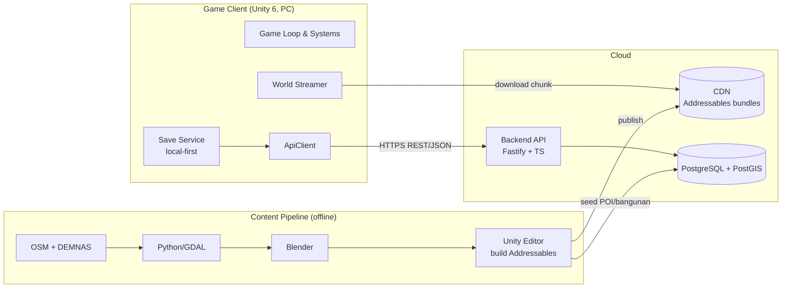
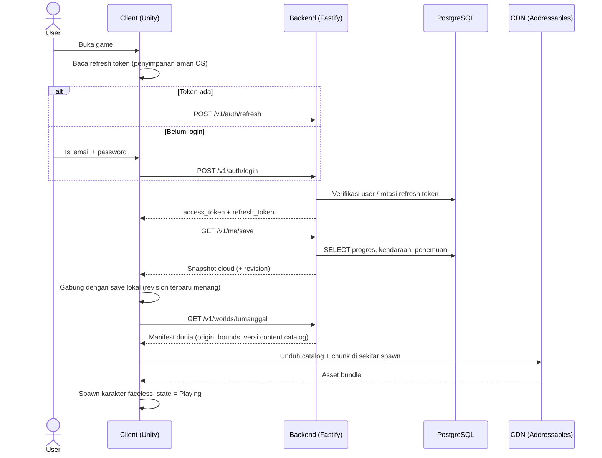
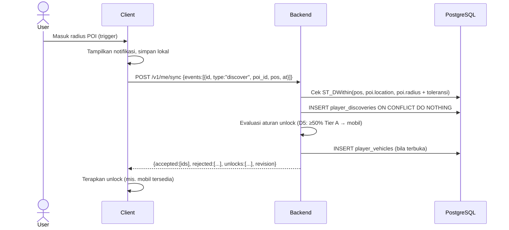
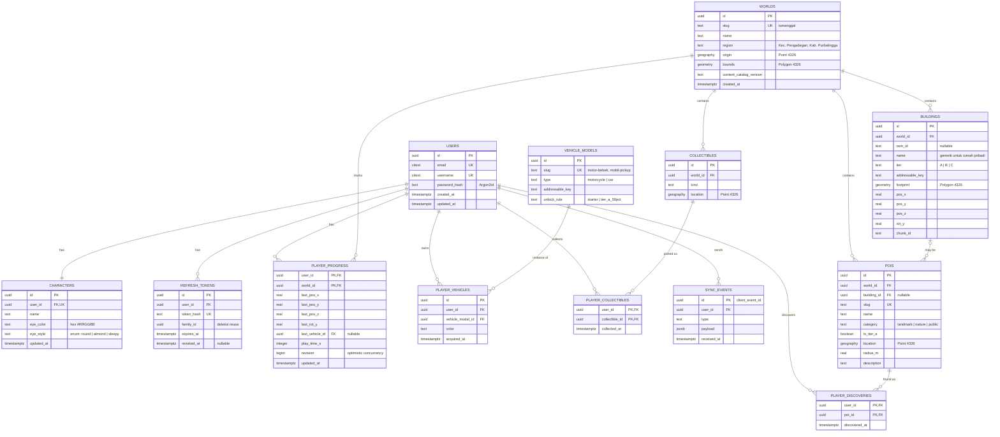

# Technical Architecture

**Produk:** Open World Real Map — Desa Tumanggal
**Status:** Draft v2 · **Terakhir diperbarui:** 2026-11-20
**Dokumen terkait:** [product-requirements.md](product-requirements.md) · [roadmap.md](roadmap.md) · [../CLAUDE.md](../CLAUDE.md)

---

## 1. Tech Stack

Stack di bawah dipilih untuk game open world semi-realistis dengan fisika kendaraan, streaming dunia per chunk, dan data geospasial. Versi dikunci di repo (lihat catatan "Pinning") — jangan naikkan versi mayor tanpa PR khusus.

### 1.1 Game Client

| Area | Pilihan | Alasan |
|---|---|---|
| Engine | **Unity 6 LTS** (C#) | Ekosistem open world matang, fisika & terrain bawaan, pipeline aset kuat, mudah dipindah ke mobile/konsol kelak. |
| Render pipeline | **URP** (Universal Render Pipeline) | Performa baik di GPU kelas menengah (spesifikasi minimum PRD §6), tetap mendukung tampilan semi-realistis. GPU Resident Drawer + GPU occlusion culling untuk dunia padat objek. |
| Streaming aset | **Addressables** | Memuat/melepas konten per chunk dunia, mendukung remote content catalog untuk menambah wilayah tanpa build ulang. |
| Input | **Input System** (package baru) | Keyboard-mouse dan gamepad dengan satu action map, mendukung remap. |
| Kamera | **Cinemachine 3** | Kamera third-person & kamera kendaraan dengan transisi halus. |
| UI / HUD | **UI Toolkit** (UXML + USS), TextMeshPro untuk teks dunia | Data binding runtime, performa lebih baik dari uGUI untuk HUD kompleks. |
| Jalan | **Unity Splines** | Jalan desa dibangun dari polyline OSM. |
| Terrain | Unity Terrain (heightmap per tile) | Kontur dari DEM. |
| Vegetasi | Terrain detail + GPU instancing | Sawah, pohon kelapa, bambu dalam jumlah besar. |
| Kendaraan | **Controller arkade kustom berbasis raycast** (suspensi raycast + gaya ban sederhana) | `WheelCollider` sulit dituning untuk motor roda dua; controller kustom memberi kontrol penuh atas rasa berkendara. |
| Async | `Awaitable` (Unity 6) | Async/await tanpa coroutine untuk loading & networking. |
| HTTP | `UnityWebRequest` dibungkus `ApiClient` | Satu titik untuk auth header, retry, timeout. |
| Serialisasi | Newtonsoft Json (`com.unity.nuget.newtonsoft-json`) | Kontrak JSON dengan server. |
| Testing | Unity Test Framework (EditMode + PlayMode) | Unit test sistem + smoke test scene. |
| Profiling | Unity Profiler, Memory Profiler, Frame Debugger | Menjaga budget NFR. |

### 1.2 Backend

| Area | Pilihan | Alasan |
|---|---|---|
| Runtime | **Node.js LTS** (versi LTS aktif, dikunci via `.nvmrc` + `engines`) | Ringan, satu bahasa untuk backend & web. |
| Bahasa | **TypeScript** (`strict: true`) | Kontrak tipe antara modul. |
| Framework | **Fastify 5** | Lebih cepat dari Express, validasi skema & serialisasi bawaan, ekosistem plugin (JWT, rate-limit, CORS, helmet). |
| Validasi | **Zod** + `fastify-type-provider-zod` | Satu skema untuk validasi request, tipe TS, dan OpenAPI. |
| Dokumentasi API | `@fastify/swagger` (OpenAPI 3.1) | Kontrak eksplisit untuk client Unity. |
| ORM | **Drizzle ORM** + drizzle-kit (migrasi) | SQL-first, mendukung tipe PostGIS (`geometry`), query transparan. |
| Database | **PostgreSQL 17+** dengan **PostGIS 3** | Data relasional + spasial (batas dunia, footprint bangunan, titik POI). |
| Auth | JWT akses (15 menit) + refresh token rotasi (30 hari, disimpan ter-hash di DB), password **Argon2id** | Standar aman untuk game client native. |
| Logging | Pino (bawaan Fastify), JSON terstruktur | Mudah dianalisis. |
| Testing | **Vitest** + Testcontainers (PostgreSQL+PostGIS asli) | Integration test tanpa mock DB. |
| Package manager | **pnpm** | Cepat, lockfile deterministik. |
| Lint/format | ESLint (flat config) + Prettier | Konsisten. |

### 1.3 Web Pendukung (Fase 3)

| Area | Pilihan |
|---|---|
| Framework | **Next.js** (App Router) + TypeScript |
| Styling | **Tailwind CSS v4** (CSS-first: `@import "tailwindcss";` + `@theme`, tanpa `tailwind.config.js`) |
| Fungsi | Landing page, halaman unduhan, panel admin (kelola POI, info landmark, melihat statistik). |

> **Penting:** Tailwind CSS **hanya** untuk web pendukung. HUD dan menu di dalam game memakai **UI Toolkit** Unity. Draft lama yang menyebut "HUD dengan Tailwind" tidak berlaku.

### 1.4 Pipeline Data Peta

| Tahap | Alat | Output |
|---|---|---|
| Jalan, sungai, footprint bangunan, landuse | **OpenStreetMap** via Overpass API / ekspor `.osm.pbf` | GeoJSON |
| Kontur tanah | **DEMNAS** (BIG, resolusi ±8 m) | GeoTIFF → heightmap RAW 16-bit |
| Referensi visual | Foto survei lapangan, Mapillary (CC BY-SA), citra satelit (hanya referensi) | Folder referensi per bangunan |
| Proyeksi | **GDAL/ogr2ogr**, proyeksi **UTM zona 49S (EPSG:32749)** lalu dikonversi ke koordinat lokal relatif titik origin | Koordinat meter |
| Modeling | **Blender** (+ add-on Blosm untuk impor OSM), modeling manual Tier A | `.fbx` / `.glb` |
| Otomasi | Python 3 (`uv`), skrip di `pipeline/` | Data siap impor Unity |

### 1.5 Infrastruktur & DevOps

| Area | Pilihan |
|---|---|
| Repo | Monorepo Git + **Git LFS** untuk biner (`.fbx`, `.png`, `.psd`, `.tif`, `.wav`, dll.) |
| CI | GitHub Actions: lint + test server; build Unity via **GameCI** (`game-ci/unity-builder`) |
| Lokal | Docker Compose: `postgis/postgis` + server |
| Deploy backend | Container (Docker) di VPS/PaaS (mis. Fly.io / Railway / VPS + Caddy) |
| Database produksi | PostgreSQL terkelola dengan ekstensi PostGIS (mis. Neon / Supabase / RDS) + backup harian |
| Hosting Addressables | Object storage + CDN (mis. Cloudflare R2 / S3 + CloudFront) |
| Monitoring | Sentry (Unity SDK + Node SDK) untuk crash & error |
| Distribusi game | itch.io (playtest) → Steam (rilis) |

**Pinning:** versi Unity dikunci di `client/ProjectSettings/ProjectVersion.txt`; package Unity di `client/Packages/packages-lock.json`; Node via `.nvmrc`; dependensi via `pnpm-lock.yaml`.

---

## 2. Arsitektur Sistem

### 2.1 Gambaran Umum



**Prinsip arsitektur:**

1. **Client memegang simulasi real-time.** Gerak pemain, fisika kendaraan, dan kamera berjalan sepenuhnya di client. Server **tidak** menerima posisi per frame.
2. **Server adalah sumber kebenaran untuk data persisten.** Akun, kepemilikan kendaraan, penemuan lokasi, dan koleksi divalidasi server (mis. pemain harus berada dalam radius POI dan kendaraan harus sudah dibuka sesuai aturan D5).
3. **Local-first save.** Progres selalu ditulis ke disk lokal dulu, lalu disinkronkan ke server secara berkala (setiap 60 detik), saat event penting (penemuan, perolehan kendaraan), dan saat keluar. Bila offline, antrean sinkron disimpan dan dikirim ulang.
4. **Konten dunia data-driven.** Bangunan dan POI didefinisikan sebagai data + aset Addressables; menambah wilayah tidak memerlukan perubahan kode.
5. **Sinkron idempoten.** Setiap event dikirim dengan `client_event_id` (UUID) sehingga pengiriman ulang tidak menggandakan data.

### 2.2 Sistem Koordinat Dunia

- **1 unit Unity = 1 meter.** Sumbu: X = timur, Z = utara, Y = atas.
- Origin dunia = titik awal Desa Tumanggal (koordinat WGS84 disimpan di `worlds.origin`). Semua data geografis diproyeksikan ke UTM 49S lalu dikurangi koordinat origin.
- Dunia dibagi **grid chunk 256 × 256 m**, ID chunk = `"{x}_{z}"` (indeks integer dari origin).
- Radius aktif: chunk dalam 2 ring di sekitar pemain dimuat penuh; ring ke-3 dimuat versi LOD rendah; sisanya dilepas.
- Cakupan MVP < 5 km dari origin sehingga **floating origin belum diperlukan**. Wajib diterapkan sebelum wilayah melebihi ±8 km dari origin.

### 2.3 Modul Client

| Modul (Assembly) | Tanggung jawab |
|---|---|
| `Game.Core` | Bootstrap, state machine game (Boot → Menu → Loading → Playing → Paused), service locator/DI, event bus. |
| `Game.World` | World streamer (chunk), terrain, jalan, batas dunia, LOD. |
| `Game.Player` | Controller karakter, animasi, `FacelessEyes`. |
| `Game.Vehicles` | `VehicleController` (abstraksi), `MotorcycleController`, `CarController`, enter/exit, kamera kendaraan. |
| `Game.Exploration` | POI, penemuan lokasi, interaksi, koleksi, foto mode. |
| `Game.Save` | Snapshot progres, serializer tervalidasi, antrean sinkron. |
| `Game.Net` | `ApiClient`, auth & refresh token, DTO. |
| `Game.UI` | HUD, minimap, world map, menu (UI Toolkit). Hanya membaca state lewat event/ViewModel. |

Arah dependensi: `UI → (Exploration, Vehicles, Player, World) → Core`; `Save → Net → Core`. Modul gameplay **tidak** boleh bergantung ke `Game.UI`.

---

## 3. Alur Utama (Sequence)

### 3.1 Login & Masuk Dunia



### 3.2 Penemuan Lokasi & Sinkron



### 3.3 Berkendara

Berkendara sepenuhnya di client (tidak ada request per aksi). Yang disinkronkan hanya **posisi terakhir dan kendaraan terakhir** di dalam snapshot periodik (`POST /v1/me/sync`, event `checkpoint`). Server menolak checkpoint yang menyiratkan kecepatan tidak wajar (> 60 m/s antar dua checkpoint) — hanya ditandai, tidak memblokir pemain.

---

## 4. API (v1)

Base URL: `https://api.<domain>/v1` · Format: JSON · Auth: `Authorization: Bearer <access_token>` kecuali `/auth/*`.

| Method | Endpoint | Deskripsi |
|---|---|---|
| POST | `/auth/register` | Registrasi (email, username, password). |
| POST | `/auth/login` | Login → access + refresh token. |
| POST | `/auth/refresh` | Rotasi refresh token. |
| POST | `/auth/logout` | Cabut refresh token aktif. |
| GET | `/me` | Profil + karakter. |
| PATCH | `/me/character` | Ubah nama/warna/gaya mata. |
| GET | `/me/save` | Snapshot progres lengkap + `revision`. |
| POST | `/me/sync` | Kirim batch event (`checkpoint`, `discover`, `collect`, `photo`), idempoten per event id. |
| GET | `/me/vehicles` | Kendaraan yang dimiliki. |
| GET | `/worlds/:slug` | Manifest dunia (origin, bounds, versi catalog). |
| GET | `/worlds/:slug/pois` | Daftar POI (tanpa koordinat koleksi tersembunyi). |
| GET | `/health` | Health check. |

**Aturan API:** semua request & response divalidasi Zod; error memakai format `{ "error": { "code": "STRING_CODE", "message": "...", "details": [{ "path": "...", "message": "..." }] } }`, dengan `details` opsional dan hanya untuk `VALIDATION_ERROR` (tidak pernah memuat nilai input). Daftar kode error ada di `server/docs/error-codes.md`. Rate limit auth 10 req/menit/IP untuk **seluruh** `/v1/auth/*` (satu counter bersama); di belakang proxy, IP klien dibaca lewat `TRUST_PROXY` (IP/CIDR proxy atau keyword `loopback`/`linklocal`/`uniquelocal`, default mati; hop count tidak didukung karena Fastify 5 sengaja menolak mempercayai XFF dengan hop count). `POST /me/sync` maksimal 100 event per request.

---

## 5. Database Schema

PostgreSQL + PostGIS. Konvensi: nama tabel `snake_case` jamak, PK `uuid` (UUIDv7 dibuat aplikasi), semua waktu `timestamptz` UTC, geometri dalam **SRID 4326** (WGS84) untuk data geografis; posisi dalam dunia game disimpan sebagai koordinat lokal meter (`pos_x/y/z`).

### 5.1 Perubahan dari Draft v1

| Draft v1 | v2 | Alasan |
|---|---|---|
| `vehicles` menyimpan model + kepemilikan | Dipisah: `vehicle_models` (katalog) + `player_vehicles` (kepemilikan) | Hindari duplikasi data model per pemain. |
| `explored_areas json` | Tabel `pois` + `player_discoveries` | Bisa di-query, divalidasi, dan dihitung untuk unlock. |
| `status idle/in_use` di kendaraan | Dihapus; kendaraan aktif cukup `last_vehicle_id` di progres | Status real-time tidak perlu di server. |
| Koordinat `float` lat/lng | `geography(Point,4326)` / `geometry(Polygon,4326)` PostGIS | Query spasial (radius, batas wilayah) yang akurat. |
| Tidak ada token | `refresh_tokens` | Sesi aman + logout. |
| Tidak ada koleksi | `collectibles` + `player_collectibles` | Aktivitas D6. |

### 5.2 ER Diagram



### 5.3 Indeks & Constraint Penting

- `UNIQUE (user_id, vehicle_model_id)` pada `player_vehicles` — satu model per pemain di MVP.
- GiST index pada `pois.location`, `collectibles.location`, `buildings.footprint`, `worlds.bounds`.
- Index `buildings (world_id, chunk_id)` untuk ekspor per chunk.
- `sync_events.id` sebagai PK → idempotensi; event > 30 hari dapat dipangkas.
- `ON DELETE CASCADE` dari `users` ke seluruh tabel `player_*`, `characters`, `refresh_tokens`.

---

## 6. Struktur Repository

```
/
├─ CLAUDE.md                     # ringkasan proyek + indeks rules
├─ .claude/
│  ├─ rules/                     # aturan proyek per topik (sebagian dibatasi per folder)
│  └─ skills/ergonio-workflow/   # alur kerja task Ergonio
├─ docs/                         # PRD, arsitektur, roadmap, ADR
│  └─ adr/                       # Architecture Decision Records (0001-*.md)
├─ client/                       # proyek Unity 6
│  ├─ Assets/_Project/
│  │  ├─ Scripts/{Core,World,Player,Vehicles,Exploration,Save,Net,UI}/   # 1 folder = 1 .asmdef
│  │  ├─ Art/{Characters,Vehicles,Buildings,Environment,Materials}/
│  │  ├─ Prefabs/
│  │  ├─ Scenes/{Boot,Menu,World}.unity
│  │  ├─ Settings/               # URP asset, Input Actions, ScriptableObject config
│  │  ├─ UI/                     # UXML, USS
│  │  └─ Tests/{EditMode,PlayMode}/
│  ├─ Packages/
│  └─ ProjectSettings/
├─ server/                       # Fastify + TypeScript
│  ├─ src/
│  │  ├─ modules/{auth,me,worlds,sync}/   # routes, schemas (zod), service, repository
│  │  ├─ db/{schema.ts,migrations/,seed/}
│  │  ├─ plugins/                # jwt, rate-limit, swagger, error handler
│  │  └─ lib/
│  ├─ test/
│  └─ Dockerfile
├─ pipeline/                     # skrip data peta (Python + Blender)
│  ├─ scripts/
│  └─ data/                      # raw data (gitignored), output terproses (LFS)
├─ web/                          # Next.js + Tailwind v4 (Fase 3)
├─ docker-compose.yml
└─ .github/workflows/
```

---

## 7. Budget Performa

| Metrik | Budget (preset Medium, spesifikasi minimum) |
|---|---|
| Frame time | ≤ 16,6 ms (CPU main thread ≤ 10 ms) |
| Draw call (SRP batches) | ≤ 2.000 |
| Segitiga terlihat | ≤ 1,5 juta |
| Chunk bundle | ≤ 20 MB terkompresi per chunk |
| Tekstur | BC7/DXT5 untuk PC, maks 2K untuk Tier A, 1K Tier B, atlas untuk Tier C |
| LOD | 3 level (LOD0/1/2) + culled untuk semua bangunan Tier A/B |
| GC alloc per frame (gameplay) | 0 B di jalur update utama |
